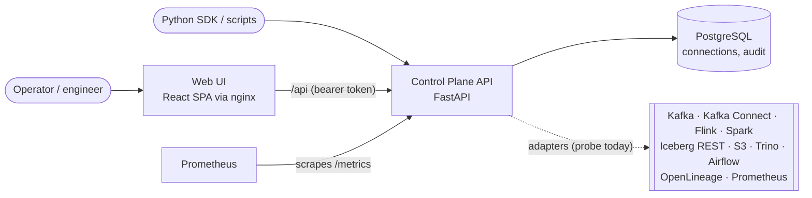
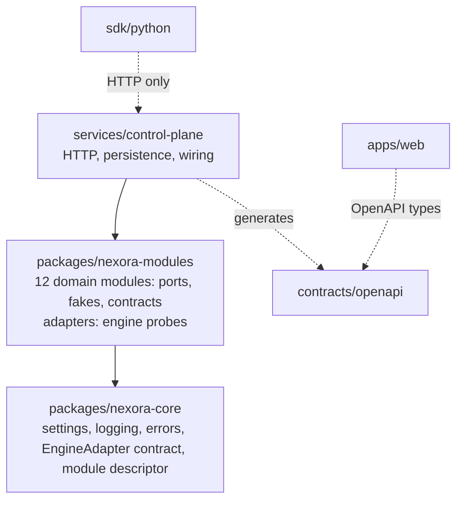

# NEXORA architecture overview

NEXORA is a **control plane for a lakehouse data platform**. It does not move or transform data itself: it
registers engine connections, observes them, submits and tracks work (as modules mature), enforces policy
and records audit and lineage. See [ADR-0009](../adr/0009-data-platform-target-architecture.md) for the
target data platform and [PROJECT_STATUS](../status/PROJECT_STATUS.md) for what actually exists today.

## System context

Solid arrows exist and are tested. The dotted arrow is health probing only; no engine is driven functionally yet.

## Repository layers

Dependency direction is enforced by `import-linter` (`make validate`). Domain modules are independent of each
other and of the adapters; only the control plane composes them.

## Domain modules

Twelve modules, each with `module.toml` (responsibilities, interfaces, engines, config, acceptance
criteria), a port (`ports.py`), immutable models, an in-memory fake and contract tests:

`ingestion` · `cdc` · `streaming` · `processing` · `lakehouse` · `query` · `orchestration` · `governance` ·
`quality` · `lineage` · `observability` · `ai`

The catalog with live maturity and acceptance progress is served by `GET /api/v1/modules` and shown in the UI.

## Engine adapters

`EngineAdapter` (core) is the single port for third-party engines; implementations live in
`nexora_modules.adapters`. Maturity levels and promotion rules: [ADR-0004](../adr/0004-engine-adapters-and-maturity.md).
Per-engine contracts: [`contracts/adapters/`](../../contracts/adapters).

## Control Plane API (v1)

| Endpoint | Auth | Purpose |
|---|---|---|
| `GET /healthz`, `GET /readyz`, `GET /metrics` | none | liveness, readiness (DB), Prometheus metrics |
| `GET /api/v1/platform` | bearer | version, environment, git SHA |
| `GET /api/v1/modules`, `GET /api/v1/adapters` | bearer | module catalog and adapter maturity |
| `GET/POST /api/v1/connections`, `GET/DELETE /api/v1/connections/{name}` | bearer | engine connection registry |
| `GET /api/v1/connections/{name}/health`, `GET /api/v1/health/connections` | bearer | live probes |
| `GET /api/v1/audit-events` | bearer | audit log of mutations |

Errors use one envelope `{"error": {"code", "message", "details"}}`. The machine-readable contract is
[`contracts/openapi/control-plane.v1.json`](../../contracts/openapi/control-plane.v1.json); CI fails if the
code and the snapshot differ.

## Cross-cutting decisions

Configuration and secrets: [ADR-0008](../adr/0008-configuration-and-secrets.md) · Supply chain:
[ADR-0007](../adr/0007-supply-chain-and-pinning.md) · Migrations: [ADR-0010](../adr/0010-database-migrations.md) ·
Auth: [ADR-0006](../adr/0006-authentication-and-authorization.md).
