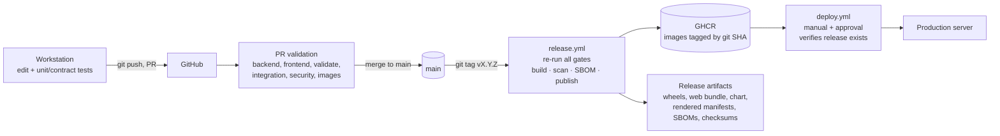
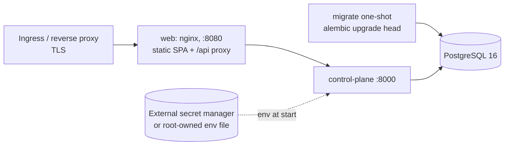

# Server deployment architecture

Operational procedures (step by step) are in [`docs/operations/`](../operations/deployment.md). This page
explains the shape of the system and why.

## Delivery pipeline

Nothing deploys from a branch or from source: only an image that the release workflow built, scanned and
published for a commit on `main`.

## Runtime topologies

| Topology | Use for | Assets |
|---|---|---|
| Docker Compose, single node | first servers, staging, small production | `deploy/compose` |
| Kubernetes (kustomize) | clusters, GitOps | `deploy/kubernetes` (base + staging/production overlays) |
| Kubernetes (Helm) | clusters preferring Helm | `deploy/helm/nexora` |

In Kubernetes/Helm, PostgreSQL is an external or managed instance (URL supplied through the external
secret); compose ships a Postgres container for single-node use only.

All three run the same two images (`control-plane`, `web`) plus PostgreSQL, run migrations as a one-shot step
before the application, expose the same health endpoints and are validated by the same smoke test
(`tests/smoke/smoke.py`).

## What is deliberately not here

The data engines (Kafka, Flink, Spark, Iceberg catalog, object storage, Trino, Airflow, ...) are **not**
bundled in these manifests. They are deployed and sized on their own infrastructure, and registered in NEXORA
as connections. A deployment that "includes" them without a verified adapter would only prove containers
start, not that the platform works.

## Properties verified vs not yet verified

See [TEST_EVIDENCE](../status/TEST_EVIDENCE.md). In short: compose and kustomize render and pass static
policy checks on the workstation; image builds, Helm rendering, the CI integration job and the deploy
workflow are verified only once the repository runs in GitHub Actions and on a real server.
